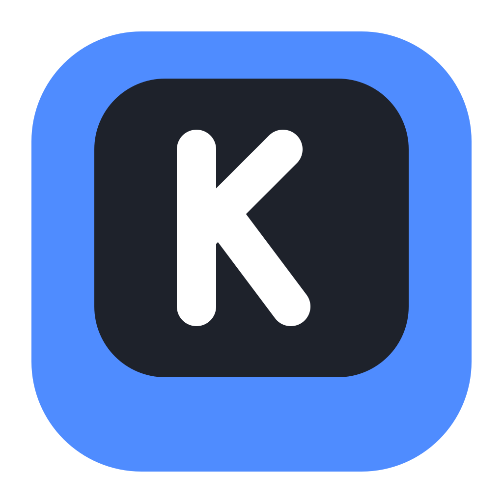

<p align="center">
  
</p>

<h1 align="center">Keystroke Overlay</h1>

<p align="center">
  <b>Show your keyboard live on stream.</b> A lightweight, private keystroke overlay for OBS.
</p>

<p align="center">
  <a href="https://github.com/nqble/keystroke-overlay/releases/latest"></a>
  <a href="https://github.com/nqble/keystroke-overlay/releases"></a>
  
  <a href="LICENSE"></a>
</p>

<p align="center">
  <a href="https://github.com/nqble/keystroke-overlay/releases/latest"><b>Download</b></a> ·
  <a href="docs/USER-GUIDE.md">User guide</a> ·
  <a href="PRIVACY.md">Privacy</a> ·
  <a href="CONTRIBUTING.md">Contribute</a>
</p>

<!-- DEMO: a short gameplay video of the overlay in OBS goes here. -->

## Why Keystroke Overlay

- 🪶 **Light.** About 3 MB of memory on Windows and ~0% CPU when idle. The installer is about 2.3 MB.
- 🎮 **Works in games.** It sees your keys while a game has focus, and has a Compatibility mode for games that block
  the usual method. [Games tested so far](docs/GAMES.md).
- 🎨 **Yours to design.** Pick a keyboard or build your own, then choose a theme, fine-tune every color and add an
  animation.
- 🔒 **Private by design.** Keystrokes never leave your PC: never saved, never sent. An automatic check in every
  build enforces it.

## Features

### Layouts

Full size, TKL, 60% to 96%, ISO, gameplay clusters and numpads, or a layout of your own. Drag the cards into the order
you like; the tray menu follows it.

<!-- MEDIA: Layout tab, cards being dragged and New layout's Built-in list (docs/media/layouts.webp) -->

### Key editor

Hide keys, give them your own labels (`⎵`, `Jump`), and drag them anywhere on a zoomable board. Align, space evenly,
undo and redo. Edits are saved per layout.

<!-- MEDIA: Keys tab, moving and relabeling keys (docs/media/keys.webp) -->

### Themes and style

Start from a theme, then adjust colors, shape, text and size, or use your own fonts. Save a look as a preset and share
it as a file.

<!-- MEDIA: Style tab, clicking through themes while the preview changes (docs/media/style.webp) -->

### Animations

Press down, bounce, glow, fade, scale. Hover a card to see it, then set its speed, strength and easing. Animations use
only the graphics card's cheapest effects, so streams stay smooth.

<!-- MEDIA: Animation tab, hovering the cards (docs/media/animation.webp) -->

## Get started

1. **Download** it from [Releases](https://github.com/nqble/keystroke-overlay/releases/latest) and run it: the installer on
   Windows, the Apple Silicon app on a Mac, the `.deb` or AppImage on Linux. Releases are not code-signed yet, so on Windows
   click **More info → Run anyway** if SmartScreen warns, and on a Mac allow the first launch in **System Settings → Privacy &
   Security → Open Anyway** ([details](docs/USER-GUIDE.md#on-a-mac)).
2. **Copy the OBS URL.** The app opens on three short setup steps the first time.
3. **In OBS:** Sources → **+** → **Browser**, paste the link and set the size the app shows. Done.

**Is it safe?** Antivirus tools are wary of any program that reads the keyboard, and now and then one flags a new
version by mistake. Keystroke Overlay is open source, official releases come only from the Releases page, and an
automatic check on every change makes sure keystrokes are never saved or sent. If your antivirus warns about an official
release, please [open an issue](https://github.com/nqble/keystroke-overlay/issues).

More in the [user guide](docs/USER-GUIDE.md): the best OBS settings, two-PC setups, input methods, the secure link and
troubleshooting.

## Privacy

This app has to read your keyboard to work, so here is exactly what happens:

```
your keyboard → your system → Keystroke Overlay (in memory) → a page on YOUR PC (127.0.0.1) → OBS
```

- Keys are **never written to disk, logged or sent** over the network.
- The only internet contact is **GitHub, for updates and release notes**, and the automatic check can be turned off.
- No account, no analytics, no telemetry. Use **Pause overlay** before typing anything private on stream.

The full account, with ways to check every line yourself: [PRIVACY.md](PRIVACY.md).

## Building from source

### On Windows

You need Windows 10/11, [Rust](https://rustup.rs) (MSVC toolchain) with Visual Studio Build Tools, and
[Node.js](https://nodejs.org) 20+.

```bash
git clone https://github.com/nqble/keystroke-overlay.git
cd keystroke-overlay
npm install
npm run dev          # run it
npm run dev:debug    # run a separate development copy with Debug mode on (see docs/DEBUGGING.md)
npm test             # unit tests (including hostile-input tests) + privacy and every-system checks
npm run format       # format the code (Prettier + rustfmt); CI checks it
npm run check:style  # tabs, trailing spaces, final newline, no inline styles in the settings scripts
npm run check:docs   # where each document lives, the indexes, working links
npm run check:config # the app's name, repository and identifiers agree everywhere
npm run test:e2e     # end-to-end tests (builds a throwaway copy, cleans up after itself)
npm run test:install # clean install + upgrade + uninstall with real installers (throwaway identity)
npm run test:quiet-update # a real in-app update: no installer window, the app reopens by itself
npm run test:visual  # a picture of every settings screen and of the overlay in each theme, compared with the saved ones
npm run build        # installer in src-tauri/target/release/bundle/nsis/
```

### On a Mac

From v2.0 each release has an **Apple Silicon download**. It isn't notarized, so the first launch needs **Open Anyway**
in System Settings → Privacy & Security, and macOS asks for keyboard access again after every update: the steps are in
[the user guide](docs/USER-GUIDE.md#on-a-mac). Or build it yourself; you need the Xcode Command Line Tools,
[Rust](https://rustup.rs) and [Node.js](https://nodejs.org) 20+.

```bash
git clone https://github.com/nqble/keystroke-overlay.git
cd keystroke-overlay
npm ci
npx tauri build --bundles app --config '{"bundle":{"createUpdaterArtifacts":false}}'   # the app: src-tauri/target/release/bundle/macos/
```

First launch, keyboard access and troubleshooting: [docs/USER-GUIDE.md](docs/USER-GUIDE.md#on-a-mac).

Built with [Tauri](https://tauri.app) (Rust + the system's own web view), plain JavaScript with [Preact](https://preactjs.com) in the
settings window, and the help of [Claude Code](https://claude.com/claude-code): [how it's built](docs/HOW-IT-WAS-BUILT.md).

## Contributing

Contributions are welcome: see [CONTRIBUTING.md](CONTRIBUTING.md). How the code is organized:
[docs/ARCHITECTURE.md](docs/ARCHITECTURE.md). Adding a layout, theme or animation is one file:
[docs/EXTENDING.md](docs/EXTENDING.md). Debugging tools: [docs/DEBUGGING.md](docs/DEBUGGING.md).

## Code signing

Releases are **not code-signed yet**, so Windows may show a SmartScreen warning the first time you install
(**More info → Run anyway**). Every update the app installs is signed with the project's own update key, and the app
installs nothing else. The project may apply for free code signing again once it is better known
([decision 0012](docs/decisions/0012-releases-stay-unsigned-for-now.md)).

## License

[MIT](LICENSE) © 2026 Jordan Phoutthavone. Third-party components keep their own licenses.

### Name and logo

The MIT license covers the **code**. It does not cover the **name "Keystroke Overlay"**, the **logo** or the **author's
name**, which identify the official app by Jordan Phoutthavone. You're welcome to fork, change and share the code, but if
you publish your own version:

- give it a **different name and logo**, so people can tell it apart from the official app;
- don't present it as the official app, or as made or endorsed by Jordan Phoutthavone;
- keep the copyright and license notice, as the MIT license requires. Saying "based on Keystroke Overlay by Jordan
  Phoutthavone" is welcome.

Official releases are only published at [github.com/nqble/keystroke-overlay](https://github.com/nqble/keystroke-overlay/releases)
and every update is signed with the project's update key, so the app's built-in updater only installs updates from
there.
